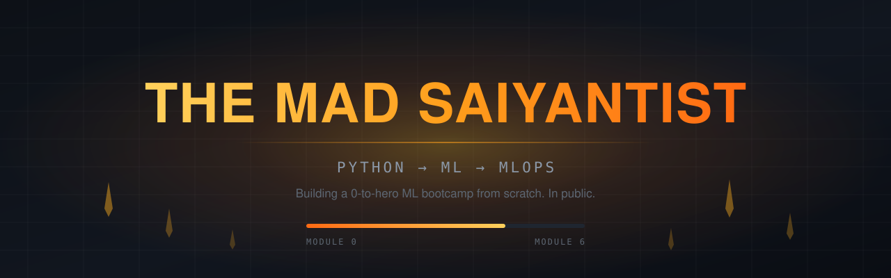
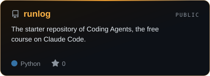
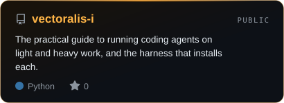

<a href="https://themadsaiyantist.com">
  <picture>
    <source media="(prefers-color-scheme: dark)" srcset="./assets/banner-dark.svg">
    <source media="(prefers-color-scheme: light)" srcset="./assets/banner-light.svg">
    
  </picture>
</a>

<picture>
  <source media="(prefers-color-scheme: dark)" srcset="./assets/typing-dark.svg">
  <source media="(prefers-color-scheme: light)" srcset="./assets/typing-light.svg">
  
</picture>

  
  
  
  
  

  <em>Most people quit at the plateau. The whole point of a training arc is that the plateau <b>is</b> the arc.</em>

---

### The bootcamp is live

**[TheMadSaiyantist ML Bootcamp](https://themadsaiyantist.com)** takes you from never having opened a terminal to a deployed, monitored, retrained model. Every module is built and online. Solo. From North Macedonia. Out loud.

**Free to learn, pay to prove it:** every lesson and every solution is free, and you pay only to be tested on Modules 1 to 6.

| | Module | Sections | Lessons | What you build |
|:-:|---|:-:|:-:|---|
| **0** | [Foundations: The Machine, the Shell, and Git](https://themadsaiyantist.com/curriculum/m0) | 3 | 11 | Free in full, no exam, no capstone |
| **1** | [Python: From First Script to Objects](https://themadsaiyantist.com/curriculum/m1) | 8 | 28 | The Run Registry |
| **2** | [Data: Queries, Arrays, and the Clean Table](https://themadsaiyantist.com/curriculum/m2) | 7 | 25 | The Dataset Autopsy |
| **3** | [Classical ML: Why It Works, and Why the Score Lies](https://themadsaiyantist.com/curriculum/m3) | 8 | 23 | The Leakage Hunt |
| **4** | [Deep Learning Foundations: PyTorch From the Tensor Up](https://themadsaiyantist.com/curriculum/m4) | 5 | 17 | The Overfit Journal |
| **5** | [Modern Architectures and Transfer Learning](https://themadsaiyantist.com/curriculum/m5) | 4 | 13 | The Fine-Tune Ladder |
| **6** | [MLOps: From Script to Monitored Service](https://themadsaiyantist.com/curriculum/m6) | 4 | 13 | Ship It and Watch It Rot |
| | **7 modules** | **39** | **130** | **6 capstones** |

Every lab runs one loop: `BUILD → BREAK → OBSERVE → FIX → EXPLAIN`. The lessons come out of an agentic generation pipeline I built, which is arguably the more interesting engineering problem.

**[Start Lesson 0.1.1 →](https://themadsaiyantist.com/curriculum/m0/s1/l1)** &nbsp;·&nbsp; [See the full curriculum](https://themadsaiyantist.com/curriculum)

---

### Free course: Coding Agents

> **Your reason is the power. The agent is the labor.**

Fifteen lessons on Claude Code take you from a first session to a harness of your own, then a broken repository you fix from zero to a tested product on your own GitHub. You brief, judge and fix. The agent does the typing.

`15 lessons` &nbsp; `30 labs, each with its solution` &nbsp; `1 harness, grown on one branch` &nbsp; `$0 for every page`

**[Open Coding Agents →](https://themadsaiyantist.com/agents)** &nbsp;·&nbsp; [Clone the starter repo, runlog](https://github.com/themadsaiyantist/runlog)

---

### Featured repos

  <a href="https://github.com/themadsaiyantist/runlog"><picture>
    <source media="(prefers-color-scheme: dark)" srcset="./assets/repo-runlog-dark.svg">
    <source media="(prefers-color-scheme: light)" srcset="./assets/repo-runlog-light.svg">
    
  </picture></a>
  <a href="https://github.com/themadsaiyantist/vectoralis-i"><picture>
    <source media="(prefers-color-scheme: dark)" srcset="./assets/repo-vectoralis-i-dark.svg">
    <source media="(prefers-color-scheme: light)" srcset="./assets/repo-vectoralis-i-light.svg">
    
  </picture></a>

---

### Power level

  
  
  
  
  
  

<b>What I actually reach for, and when</b>

 

| Layer | Tools |
|---|---|
| Language | Python, a defensible amount of Bash, SQL when the data misbehaves |
| Modelling | scikit-learn, PyTorch, XGBoost |
| Serving | FastAPI, Docker, GitHub Actions |
| Data | pandas, Polars when pandas gets slow, DuckDB when both do |
| Ops | MLflow, Prometheus, whatever the module I'm writing demands |

---

### Scouter

<picture>
  <source media="(prefers-color-scheme: dark)" srcset="./assets/stats-dark.svg">
  <source media="(prefers-color-scheme: light)" srcset="./assets/stats-light.svg">
  
</picture>

<picture>
  <source media="(prefers-color-scheme: dark)" srcset="./assets/langs-dark.svg">
  <source media="(prefers-color-scheme: light)" srcset="./assets/langs-light.svg">
  
</picture>

Drawn daily by this repo's own [GitHub Action](./.github/workflows/stats.yml) from public repositories only. No outside stats service.

---

  The free AI/ML Newsletter opens <b>November 25, 2026</b>. <a href="https://themadsaiyantist.com/future">See what opens next →</a>
    
  Every lesson is free. <a href="https://themadsaiyantist.com/curriculum/m0/s1/l1">Start at Lesson 0.1.1</a>.

